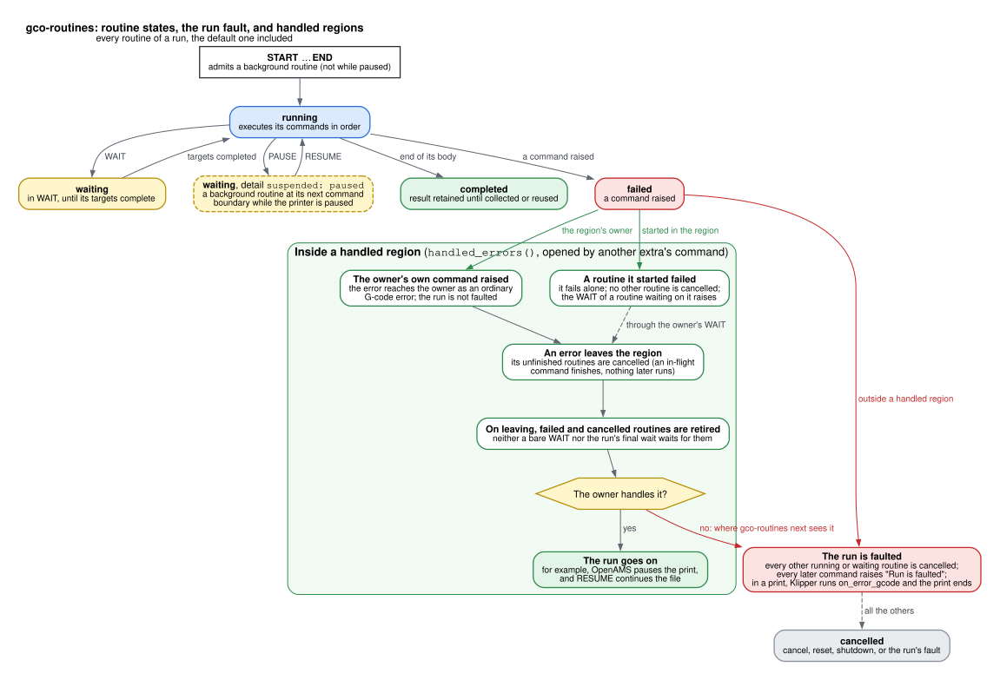

# Use it with OpenAMS

## What it is

OpenAMS ships a toolchange macro, `_TX`, that can use gco-routines to overlap
two jobs. Installing OpenAMS installs the extension but leaves it off.

## What it adds

During a toolchange, the cut, toolhead retraction and OpenAMS unload finish
first. Then the OpenAMS load (`OAMSM_LOAD_FILAMENT`) runs as a background
routine while `CLEAN_NOZZLE` runs. The nozzle gets cleaned while the AMS feeds,
so the two overlap instead of running one after the other.

Cleaning a nozzle while the filament arrives is the closest a toolchange gets
to multitasking.

### When it overlaps

`_TX` renders `START` only when every condition below holds. The last three are
checked after the cut, retraction and unload, not at the start of the macro.

| Condition | Where `_TX` checks it |
|---|---|
| The toolchange switches filament | Not an excluded object, and not the same group (and, with `SLOT`, the same slot) already loaded |
| `[gco_routines]` is loaded | `'gco_routines' in printer` |
| `_TX` is in ordered mode | `render_mode` of `gcode_macro _tx` is `ordered` in the config (the overlay file does this) |
| The printer is not paused | `printer.pause_resume.is_paused` is false |
| The lane is empty after the unload | The group loaded on the group's lane is `none`. With no lane resolved, `oams_manager.current_group` is `none` |

If any one fails, `_TX` runs serially: OpenAMS load, a one-second settle,
inlet check, then `CLEAN_NOZZLE`, one after another. It does not retry the
overlap and it does not warn you. A toolchange that needs no switch does
nothing either way.

## Requirements

- OpenAMS installed, with its `oams_macros.cfg` current. If you keep a
  customized copy, merge the updated macros first. The installer never replaces it.
- gco-routines installed ([install.md](install.md)) on a tested Klipper baseline.
- An idle printer for the restart.

## Install

`./install.sh` in the OpenAMS checkout installs both. It also copies
`oams_macros_ordered.cfg` into your configuration directory if it is absent.
Nothing includes that file yet.

## Configure the essentials

1. In `printer.cfg`, put `[gco_routines]` above `[include oams.cfg]` and before
   any other `[gcode_macro ...]` section or include that defines macros.
2. In `oams.cfg`, uncomment `[include oams_macros_ordered.cfg]` so it follows
   `[include oams_macros.cfg]`.
3. Restart Klipper while the printer is idle.

The overlay file is only this:

```ini
[gcode_macro _TX]
render_mode: ordered
```

Klipper merges it into `_TX`. All other helper macros stay in legacy mode.
Never include the overlay without `[gco_routines]`: stock Klipper rejects
`render_mode`.

## What changes

| Situation | Behavior |
|---|---|
| Normal toolchange | Unload completes, then load and nozzle cleaning overlap. `M400` ends the cleaning moves, and `WAIT` joins the load before the load result and inlet sensor are checked and before the reload extrusion. |
| Printer already paused when the toolchange started | The toolchange runs serially and loads as usual. |
| Pause arrives during the unload | The toolchange runs serially, and the helper stops it before loading. |
| Lane still holds a group after the unload | The toolchange runs serially. The serial helper then stops with an error rather than loading onto a loaded lane. |
| Pause during the overlap | No new routine starts. The toolchange stops before the toolhead reload. |
| Anything in the toolchange fails during a print (a check, the AMS, `CLEAN_NOZZLE`, a hook, the reload) | The print pauses; it does not end. `RESUME` finishes the toolchange from where it stopped. See [When a toolchange fails](#when-a-toolchange-fails). |
| Extension or overlay missing | The same macros run every step serially and never render `START`, `END` or `WAIT`. |

### When a toolchange fails

OpenAMS runs every toolchange inside `OAMSM_TOOLCHANGE`, which opens a
gco-routines *handled region* (`handled_errors()`) around the macro chain. A
failure anywhere in it, including the background load and the cleaning that
overlaps it, reaches `OAMSM_TOOLCHANGE` instead of faulting the run.
`OAMSM_TOOLCHANGE` records the failure, puts the toolhead back where the
toolchange started, and runs `PAUSE`; the print waits. Fix the cause and press
**RESUME**: OpenAMS clears the AMS's faults, works out where the lane is, runs
only what is left, and the file continues. If that fails, the print stays paused.



If the background load fails, it fails alone and the `WAIT` that joins it
reports the failure. If the cleaning fails while the load still runs, the region
cancels the load's routine: the AMS finishes the load it was given, and nothing
after it runs. OpenAMS's RESUME then sees what the AMS actually did.

This needs both sides: gco-routines with handled regions (this version) and an
OpenAMS with `OAMSM_TOOLCHANGE` (2026-11-08 or later). With an older
gco-routines, OpenAMS cannot keep the run alive, and a failed toolchange ends the
print as before. The whole OpenAMS sequence is drawn in its guide's
[How the macros run](https://github.com/OpenAMSOrg/openams/blob/main/docs/guide/macro-sequence.md).

Call `T0` to `T19` and `OPENAMS_LOAD` from ordinary G-code only. They own their
background routine, so never put them inside another `START` block.

## Check that it works

1. After the restart, Klipper is ready and `printer["gco_routines"]` exists
   (see [install.md](install.md#check-that-it-works)).
2. Run a toolchange with the printer homed, hot and unpaused.
3. While it loads, the nozzle cleaning moves run at the same time.
4. Afterward, `gco_routines` reports `fault` as `null`.

## Troubleshooting

| Symptom | Likely cause | Fix |
|---|---|---|
| `Option 'render_mode' is not valid in section 'gcode_macro _tx'` | The overlay is included without the extension | Add `[gco_routines]`, or remove the overlay include |
| `[gco_routines] must be loaded before [gcode_macro ...]` | Section order | Move `[gco_routines]` above all macros |
| Toolchanges still run serially | A condition in [When it overlaps](#when-it-overlaps) fails: overlay not included, printer paused, lane not empty, or macro copy outdated | Check both config lines; merge the current `oams_macros.cfg` |
| `Nested spawning is not permitted in v0.2; macro _TX owns background routines` | A `T0`..`T19` call sits inside a `START` block | Call it from ordinary G-code |

See [troubleshooting.md](troubleshooting.md).

## Update and uninstall

To turn the feature off, comment out both lines (the section and the include)
and restart. To update, rerun OpenAMS's `install.sh`: a clean `main` checkout of
gco-routines is fast-forwarded. OpenAMS's `-u` leaves the extension in place.
To remove it, see [install.md](install.md#update-and-uninstall).

## Gotchas

- If the extension cannot load, Klipper stops at startup and says why. That
  beats finding out mid-print.
- A serial toolchange is not a fault. It is the same work, a little slower.
- Optional toolhead inlet and outlet checks stay off until you configure the switches.
- The macro's default minimum toolchange temperature is 170 C, set by
  `variable_minimum_extrude_temperature`, independent of `min_extrude_temp`.

## Where next

[language.md](language.md), or the OpenAMS README for the rest of its setup.
